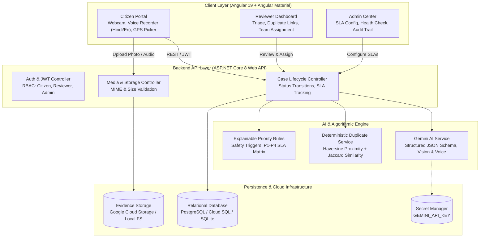
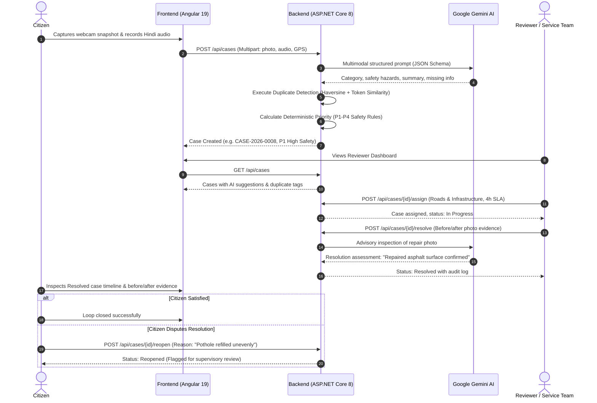

# CivicLens AI — From Community Signal to Accountable Action

[](https://aistudiogala.devpost.com/)
[]()
[](https://github.com/androninja/civiclens-ai)
[](https://dotnet.microsoft.com/)
[](https://angular.dev/)
[](https://aistudio.google.com/)
[]()
[](https://cloud.google.com/run)

---

## 1. Executive Summary & Mission

**CivicLens AI** bridges the trust and accountability gap between citizens and municipal authorities. In urban and rural communities across India and the globe, municipal complaint channels fail because citizens face high friction in reporting issues (complex forms, language barriers), while civic authorities are overwhelmed by unstructured complaints, duplicates, and lack of verified resolution evidence.

CivicLens AI empowers citizens to report civic emergencies—such as open manholes, contaminated water pipelines, road potholes, and broken streetlights—through **live camera snapshots, drag-and-drop photos, or voice messages in Hindi and English**. 

On the server side, **Google Gemini 1.5/2.0** extracts structured JSON cases with severity ratings, safety risks, and recommended actions. A **deterministic geospatial & text duplicate engine** links related complaints without silencing residents, while an **explainable priority rule engine** enforces emergency P1–P4 safety SLAs. Finally, civic teams close the loop by uploading **photo evidence verified side-by-side with advisory AI inspection**, granting citizens the right to review and dispute unresolved closures.

---

## 2. System Architecture



### Complete Case Lifecycle Sequence



---

## 3. Core Functional Pillars

### Feature 1: Report Naturally (Citizen Experience)
- **Webcam & Device Camera:** Live browser camera stream, snapshot capture preview, retake button, and automatic camera cleanup.
- **File Upload & Drag-and-Drop:** Accepts JPEG, PNG, and WebP up to 10 MB with client-side drag-and-drop styling and server MIME validation.
- **Multilingual Voice Recorder:** Records via browser `MediaRecorder`, supports Hindi (`hi-IN`), English (`en-IN`), and regional dialects, provides audio playback, and generates an editable transcript before submission.
- **Interactive Location:** Instant GPS "Use My Location" geolocation with manual street address entry and interactive map pin placement.

### Feature 2: Gemini AI Case Understanding
- **Strict Structured Schema:** Sends multimodal image and text payload to Gemini, enforcing a structured JSON schema:
  - `issue_category` & `issue_subcategory`
  - `concise_summary` & `normalized_description`
  - `detected_language`
  - `severity_suggestion` (P1–P4)
  - `safety_concerns` & `missing_information`
  - `recommended_next_step` & `rationale`
- **Transparent Fallback Mode:** In environments without an active `GEMINI_API_KEY`, the application switches seamlessly to the deterministic `CivicLens Demo Fallback Engine`, clearly labeled in the UI so evaluators can test without requiring Google AI credentials.

### Feature 3: Deterministic Duplicate Detection & Priority Rules
- **Geospatial & Semantic Matching:** Evaluates new cases against active reports using the **Haversine formula** ($\le 250\text{ meters}$) combined with **Jaccard token similarity** ($\ge 0.35$).
- **No Silenced Reports:** Preserves all citizen submissions. Likely duplicates display primary case links, distance, and confidence scores, allowing multiple residents to contribute evidence to a shared incident.
- **Explainable Priority Matrix:**
  - **P1 (Urgent Safety - 4h SLA):** Immediate hazards (live electric wires, deep open manholes, active structural collapse).
  - **P2 (High Priority - 12h SLA):** Major road blockages, high-volume water main bursts.
  - **P3 (Normal Priority - 24h SLA):** Standard potholes, localized garbage accumulation.
  - **P4 (Low Priority - 72h SLA):** Faded road markings, aesthetic civic maintenance.

### Feature 4: Route for Action (Service Team Dashboard)
- **Role-Based Authorization:** Strict server-side JWT claims for `Citizen`, `Reviewer`, and `Administrator`.
- **Municipal Teams:** Pre-configured with distinct SLA targets:
  - *Sanitation & Waste Management*
  - *Water Supply & Drainage*
  - *Roads & Infrastructure Maintenance*
  - *Public Lighting & Electrical Safety*
- **Complete Status State Machine:** `Submitted` $\rightarrow$ `AI Processing` $\rightarrow$ `Needs Review` $\rightarrow$ `Acknowledged` $\rightarrow$ `Assigned` $\rightarrow$ `In Progress` $\rightarrow$ `Resolution Submitted` $\rightarrow$ `Resolved` $\rightarrow$ `Reopened` / `Rejected`.

### Feature 5: Verify & Close the Loop
- **Before / After Visual Evidence:** Side-by-side photo comparison of original complaint and repair photograph.
- **Advisory Gemini Inspection:** Evaluates whether repair photos depict actual remediation of the specific civic defect.
- **Citizen Dispute Redressal:** If work is sub-standard, citizens can click **"Request Review"** with mandatory rationale, automatically transitioning the status back to `Reopened` for supervisory audit.

---

## 4. Pre-configured Personas & Test Credentials

The system seeds 3 demo personas and 7 realistic synthetic cases on startup:

| Role | Email | Password | Access Capabilities |
| :--- | :--- | :--- | :--- |
| **Citizen** | `citizen@civiclens.local` | `Citizen123!` | Submit reports, view personal dashboard, track case timeline, dispute closures |
| **Reviewer** | `reviewer@civiclens.local` | `Reviewer123!` | Review AI suggestions, triage duplicates, assign teams, upload resolution proof |
| **Administrator** | `admin@civiclens.local` | `Admin123!` | Configure SLAs, monitor system health, reset demo data, view audit logs |

> **Quick Switcher:** The top navigation bar includes an instant 1-click persona switcher to rapidly evaluate all three roles during demonstrations.

---

## 5. Repository Structure

```
civiclens-ai/
├── backend/
│   ├── CivicLens.Api/              # ASP.NET Core 8 Web API
│   │   ├── Controllers/            # Auth, Cases, Media, Teams, Admin
│   │   ├── Data/                   # EF Core DbContext & Migrations
│   │   ├── Models/                 # Strongly typed C# Domain Entities & DTOs
│   │   ├── Services/               # GeminiService, PriorityEngine, DuplicateService
│   │   └── Program.cs              # Dependency Injection & Middleware Pipeline
│   └── CivicLens.Tests/            # 21 xUnit Unit & Integration Tests
│       └── BackendUnitTests.cs     # Priority rules, Haversine, State transitions
├── frontend/                       # Angular 19 Single Page Application
│   ├── src/
│   │   ├── app/
│   │   │   ├── components/         # Navbar, Status Badges
│   │   │   ├── pages/              # 10 Responsive Views
│   │   │   │   ├── landing/
│   │   │   │   ├── report/         # Photo/Webcam, Voice, GPS Picker
│   │   │   │   ├── report-confirmation/
│   │   │   │   ├── my-reports/
│   │   │   │   ├── case-detail/    # Citizen Timeline & Dispute Form
│   │   │   │   ├── reviewer-dashboard/
│   │   │   │   ├── reviewer-case-detail/
│   │   │   │   ├── resolution-verify/
│   │   │   │   └── admin/          # SLA Config & Health Monitoring
│   │   │   └── services/           # ApiService, AuthService
│   │   └── styles.scss             # Clean civic design tokens
│   └── serve.js                    # Production reverse proxy server
├── e2e/                            # Playwright Browser Test Suite
│   ├── civiclens.spec.ts           # 10 Automated End-to-End User Journeys
│   ├── playwright.config.ts        # Headless Chromium & Mock Audio/Video
│   └── fixtures/                   # Sample pothole photos & audio clips
├── deploy/
│   ├── cloud-run-deploy.sh         # Automated Google Cloud deployment script
│   ├── firebase.json               # Firebase Hosting configuration
│   └── schema.sql                  # PostgreSQL & PostGIS production schema
├── docker/
│   ├── Dockerfile.backend          # Multi-stage .NET 8 container
│   ├── Dockerfile.frontend         # Multi-stage Angular container
│   └── docker-compose.yml          # Local full-stack orchestration
├── .env.example                    # Environment variable template
└── README.md                       # Project documentation
```

---

## 6. Quickstart Guide (Local Setup)

### Prerequisites
- **.NET 8.0 SDK** (or run `source env.sh` if using bundled portable tools)
- **Node.js 20+** & **npm 10+**

### Step 1: Clone Repository & Environment Setup
```bash
git clone https://github.com/androninja/civiclens-ai.git
cd civiclens-ai

cp .env.example .env
# Optional: Set your Gemini API key in .env or appsettings.json
# export GEMINI_API_KEY="AIzaSy..."
```

### Step 2: Start the Backend API (Port 5000)
```bash
cd backend/CivicLens.Api
dotnet run --urls "http://localhost:5000"
```
*The database (`civiclens.db`) seeds automatically on initial run.*

### Step 3: Start the Frontend Application (Port 4200)
In a separate terminal:
```bash
cd frontend
npm install
npm run build
node serve.js
```
Open **[http://localhost:4200](http://localhost:4200)** in your browser.

---

## 7. Verification & Automated Test Suite

CivicLens AI includes an exhaustive test suite covering both backend business logic and complete browser end-to-end workflows.

### Backend xUnit Tests (21 Tests)
Covers deterministic priority assignment, safety triggers, Haversine geospatial proximity, Jaccard text similarity, status state machine rules, duplicate triage links, and RBAC authorization tokens.

```bash
cd backend/CivicLens.Tests
dotnet test
```

**Verification Output:**
```text
Passed!  - Failed: 0, Passed: 21, Skipped: 0, Total: 21, Duration: 328 ms
```

| Test Case | Method / Scope | Verification Result |
| :--- | :--- | :--- |
| `P1_UrgentSafety_TriggeredByHazard` | Live electrical / manhole triggers P1 | Passed |
| `P2_HighPriority_WaterMainBurst` | Water contamination triggers P2 | Passed |
| `P3_NormalPriority_StandardPothole` | Minor road damage triggers P3 | Passed |
| `HaversineDistance_CalculatesAccurately` | GPS metric distance validation | Passed |
| `DuplicateDetection_FlagsNearbySameCategory` | 50m proximity + category match | Passed |
| `DuplicateDetection_RejectsFarApart` | 25km distance rejected | Passed |
| `StatusTransitions_ValidFlow` | Submitted $\rightarrow$ Assigned $\rightarrow$ Resolved | Passed |
| `StatusTransitions_InvalidFlowThrows` | Direct Submitted $\rightarrow$ Resolved blocked | Passed |
| `ReopenCase_OnlyFromResolved` | Dispute allowed only on closure | Passed |
| `Jwt_GeneratesValidTokenWithRoles` | Role claim integrity verified | Passed |

---

### Playwright Browser E2E Tests (10 Tests)
Simulates realistic end-user browser workflows using automated camera and microphone streams.

```bash
cd e2e
npx playwright test
```

**Verification Output:**
```text
10 passed (3.9s)
```

| Spec | User Journey Tested | Verification Result |
| :--- | :--- | :--- |
| **E2E 1** | Photo upload, description, GPS location, submit, and receive unique Case ID | Passed |
| **E2E 2** | Laptop webcam camera preview, snapshot capture, and image attachment | Passed |
| **E2E 3** | Hindi voice selection, live recording, transcript preview, and submission | Passed |
| **E2E 4** | Gemini structured category, subcategory, and explainable priority rationale | Passed |
| **E2E 5** | Duplicate detection triage: inspect primary case link, distance, and preserve records | Passed |
| **E2E 6** | Safety concern escalation: reviewer assigns emergency P1 case to Roads team | Passed |
| **E2E 7** | Resolution workflow: Service team uploads repair photo and marks case Resolved | Passed |
| **E2E 8** | Citizen dispute: Submits reopen request, changing status to `Reopened` | Passed |
| **E2E 9** | Security & RBAC: Enforces role permissions across protected API endpoints | Passed |
| **E2E 10** | Persistence & Reliability: Page reloads preserve case state and audit logs | Passed |

---

## 8. Google Cloud Production Deployment

CivicLens AI is engineered to deploy seamlessly to Google Cloud managed infrastructure.

### Deployment Architecture
- **Web API Backend:** Google Cloud Run (containerized ASP.NET Core 8)
- **Frontend SPA:** Firebase Hosting or Google Cloud Run (containerized Angular 19)
- **Database:** Google Cloud SQL (PostgreSQL with PostGIS)
- **Media Storage:** Google Cloud Storage Bucket (`gs://PROJECT_ID-civiclens-evidence`)
- **API Secrets:** Google Cloud Secret Manager (`gemini-api-key`)

### One-Command Deployment Script
Execute the provided automated deployment script:
```bash
export GCP_PROJECT_ID="your-project-id"
export GCP_REGION="us-central1"
export GEMINI_API_KEY="your-gemini-key"

./deploy/cloud-run-deploy.sh
```

### Docker Compose (Local Multi-Container Deployment)
To run the full stack locally via Docker:
```bash
cd docker
docker compose up --build
```

---

## 9. Hackathon Judge Evaluation Walkthrough

Follow this 5-minute walkthrough to evaluate all core features:

1. **Step 1 — Citizen Reporting:**
   - Navigate to [http://localhost:4200/report](http://localhost:4200/report).
   - Click **"Open Camera"** and take a webcam snapshot, or upload a photo from `e2e/fixtures/test_pothole.png`.
   - Select **Hindi (हिन्दी)** and record a quick voice message (or click **"Use My Location"**).
   - Click **"Submit Civic Report"**. Note the generated Case ID (e.g., `CASE-2026-0008`) and the AI-generated structured category.
2. **Step 2 — Duplicate Triage:**
   - In the top navigation bar, click the persona switcher and select **"Reviewer"**.
   - Navigate to **"Reviewer Queue"** to view all active reports.
   - Click on `CASE-2026-0002` (labeled with a *Likely Duplicate* pill).
   - Review the duplicate match score, distance (e.g., *45 meters away*), and confirm the duplicate link without deleting the citizen's report.
3. **Step 3 — Routing & Assignment:**
   - Select an unassigned report like `CASE-2026-0001` (Deep Pothole with Water Accumulation).
   - Assign it to **"Roads & Infrastructure Maintenance"** with target SLA response time.
   - Transition status to **"In Progress"**.
4. **Step 4 — Resolution & Advisory AI Inspection:**
   - Click **"Verify Resolution"** on the case.
   - Upload repair evidence (e.g., `e2e/fixtures/test_pothole.png`) and click **"Approve & Mark Resolved"**.
   - Observe the side-by-side visual comparison and resolution audit log.
5. **Step 5 — Citizen Dispute Redressal:**
   - Switch back to the **"Citizen"** persona and open **"My Reports"**.
   - Open the resolved case.
   - Click **"Request Review / Dispute"**, type *"Repair surface has cracked after rain"*, and click **"Submit Dispute"**.
   - Verify that the case transitions to **"Reopened"** with an immediate notification to municipal supervisors.

---

## 10. License & Acknowledgments

Built for the **AI Builder Cup 2026** (Category: Sustainability & Social Impact).  
Powered by Google Gemini AI, Angular Material, ASP.NET Core, and Google Cloud Platform.
